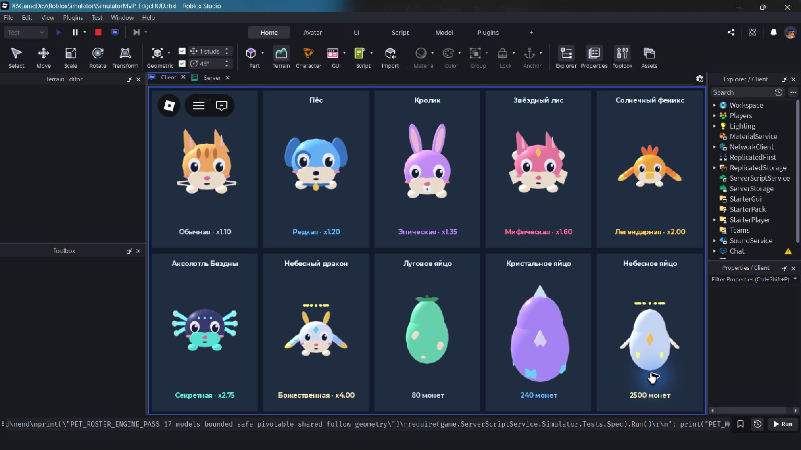

# Питомцы и яйца — набор 16.10.2026

Созданы собственные редактируемые 3D-модели из геометрии Roblox. Общий стиль: компактное округлое тело, крупные глаза с бликами, выразительный силуэт и ограниченная палитра. Это реальные модели в мире и ViewportFrame, не PNG. Один ModelFactory используется каталогом, осмотром, анимациями и серверным сопровождением. Скрипты или ассеты из чужих паков не импортировались.

| Редкость | Питомец | Множитель | Особенности модели |
|---|---|---|---|
| Обычный | Кот | x1.10 | Рыжая шерсть, полоски, усы, кремовый кончик хвоста |
| Редкий | Пёс | x1.20 | Голубой окрас, висячие уши, пятно, ошейник и золотой жетон |
| Эпический | Кролик | x1.35 | Лиловый окрас, длинные уши, зубки и круглый хвост |
| Мифический | Звёздный лис | x1.60 | Розовый окрас, белые щёки, два хвоста и золотой кристалл |
| Легендарный | Солнечный феникс | x2.00 | Огненный хохолок, крылья с тремя перьями и тройной хвост |
| Секретный | Аксолотль Бездны | x2.75 | Тёмное тело, шесть бирюзовых жабр и хвостовой плавник |
| Божественный | Небесный дракон | x4.00 | Жемчужное тело, золотые рога, крылья, хвост и ореол |

Улучшенные варианты сохраняют особенности вида и получают парящую корону с камнями; личный коэффициент ровно в четыре раза выше исходного. Слотов по-прежнему три. Это тестовый баланс; редкие виды намеренно можно получить без Robux.

## Яйца

- Луговое: 80 монет; зелёная скорлупа, кремовые пятна, листья и стебель. Кот 60%, Пёс 30%, Кролик 10%.
- Кристальное: 240 монет; лиловая скорлупа, голубые кристаллы по основанию и на вершине. Кот 20%, Пёс 45%, Кролик 35%.
- Небесное: 2.5K монет; светлая скорлупа, золотой ореол, маленькие крылья и камень. Звёздный лис 55%, Феникс 30%, Аксолотль 12%, Дракон 3%.

Все три доступны с уровня 0. Центры стоек разнесены на 11 studs; радиус взаимодействия 5.25 не пересекается. Нет открытого центрального блока внутри оболочки. Скорлупа собрана из двух перекрывающихся овалов с более узкой верхушкой; это геометрическая стилизация яйца.

## Каталоги и совместимость

Удалены только декоративные пустые тестовые карточки. Карточки настоящих, ещё не полученных видов остаются с неактивной экипировкой. Донатная вкладка остаётся текстовой заглушкой без пустых карточек. Утверждённая раскладка интерфейса сохранена.

Старые Cat/Dog/Bunny и их улучшенные ID, цены и вероятности первых двух яиц не менялись. Профиль остаётся версии 4; новые виды используют существующие поля Pets/EquippedPets. Сервер выбирает результат, списывает монеты и проверяет дистанцию, вместимость, уровень и темп запросов. Совмещение, экипировка и лучшие питомцы используют общую конфигурацию.

Модели создаются функцией `src/shared/ModelFactory.lua`; цвета/бонусы/шансы — `src/shared/Config.lua`. В серверном сопровождении геометрия клонируется из той же фабрики и приваривается к HumanoidRootPart, без коллизий и массы. Скрытие чужих питомцев поддерживает OwnerUserId. Для просмотра модели в редакторе можно вызвать Factory.Build из Command Bar и поместить результат в Workspace; результат временный, исходник фабрики остаётся главным.

## Примеры для визуального направления

- [Low Poly Simulator Pet Asset Pack — TMATS](https://tmats.itch.io/blocky-low-poly-simulator-pet-asset-pack): компактные формы, крупные глаза, силуэт ушей/крыльев/хвостов.
- [Подборка Pet Simulator моделей — Sketchfab](https://sketchfab.com/tags/petsimulator): цветовые темы и различимость маленьких спутников.

Это визуальные ориентиры, модели и файлы из этих паков не использовались.

## Проверка

`tests/RunLocal.ps1` проверяет получение всех редкостей, таблицы вероятностей, списание, совмещение каждого вида, коэффициенты и совместимость профиля. `tests/PetRosterStudioQA.server.lua` проверяет 17 моделей, геометрию, pivot, дистанции и крепление сопровождения в Studio; клиентский парный файл проверяет 3/7/0 карточек и позволяет клавишей P открыть временный обзор моделей. QA-скрипты не входят в обычную сборку.

