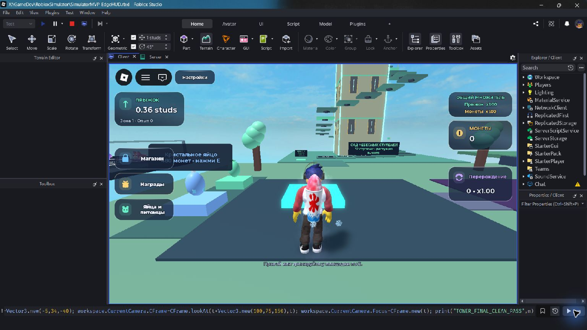
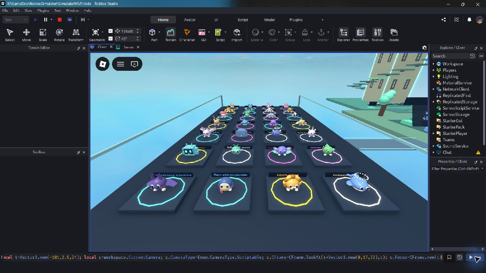
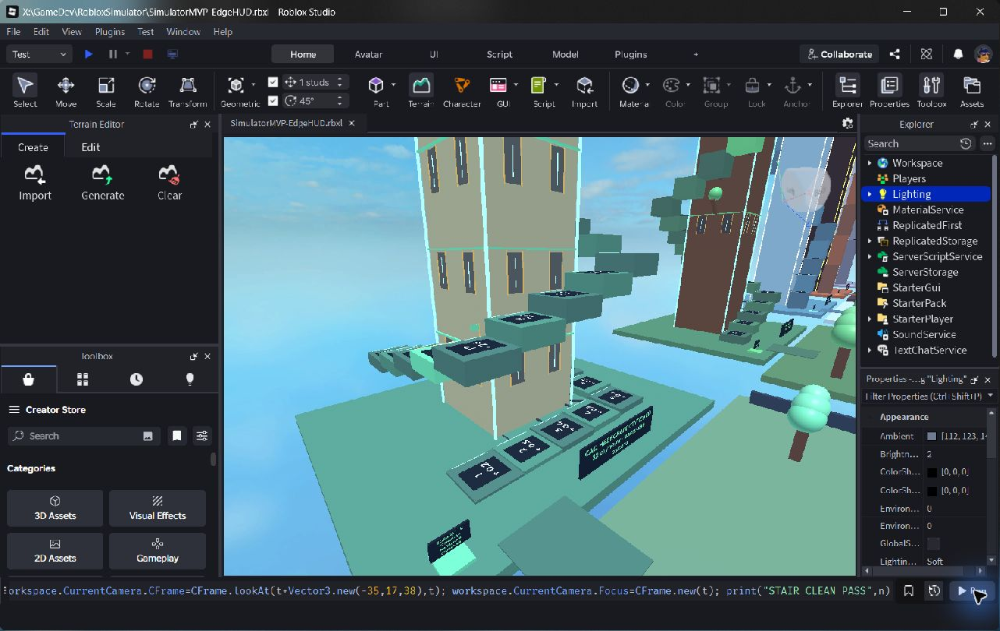

# Башни и ателье питомцев — версия для оценки, обновлена 22 октября 2026

## Что смотреть

Открыть `SimulatorMVP-EdgeHUD.rbxl` в Studio и нажать Play. Подъём находится с северной стороны каждой площади; портал следующей зоны теперь на вершине. Зал славы перенесён к южной стороне, его утверждённая геометрия сохранена. На запад от первой площади по мосту — открытая галерея: 7 действующих видов и 21 концепт. Концепты помечены отдельно; они пока не выпадают, не экипируются и не занимают инвентарь.

## Башни

| Зона | Тема | Ступени | Высота вершины | Перепад ступеней |
|---|---|---:|---:|---:|
| Луг | Сад небесных ступеней, светлый камень и золотые окна | 32 | 86 studs | 0.24–6 |
| Лес | Древо высоты, ветви и крона | 32 | 246 studs | 3–14 |
| Ледник | Шпиль северного сияния, лёд и кристаллы | 32 | 594 studs | 10–30 |
| Вулкан | Сердце вулкана, базальт и светящиеся жилы | 32 | 1329 studs | 24–65 |
| Небеса | Небесная обсерватория, орбиты и астральное сердце | 32 | 2316 studs | 48–105 |

По уточнению пользователя от 22 октября это непрерывная лестница в два витка, а не паркур из раздельных платформ. Каждая ступень — сплошной блок с вертикальным подступенком до предыдущей ступени. Центры соседних ступеней находятся в 9 studs друг от друга; ширина 9, горизонтальный зазор 0. Верх последней ступени совпадает с высотой обзорной площадки: на неё можно пройти без дополнительного прыжка. Над выходом оставлен открытый лестничный проём. Перепад растёт по кривой степени 1.35. Таблички на ступенях показывают номер и требуемый перепад. Верхние площадки, флаги, декоративные окна и карнизы помогают считывать масштаб. Декор не создаёт невидимых коллизий. Нет SpawnLocation и видимой платформы спавна.

Отметки отдыха — 8/16/24/32. Сервер подтверждает стояние на реальной платформе через Raycast, высоту/скорость и доступность зоны. У подножия E возвращает к максимальной достигнутой отметке; на вершине E возвращает к яйцам. При падении в пустоту — возврат к отметке или в доступную зону. Отметки действуют **до выхода из текущего сервера**, не являются сохраняемым прогрессом и не выдают монет/XP. Сильный прыжок позволяет пропускать ступени. Это не полноценная защита от читов перемещения: сервер продолжает доверять обычной репликации персонажа Roblox; экономические действия проверяются отдельно.

Открытие зон по-прежнему требует прежних монет и активного опыта, теперь дополнительно нужно добраться до портала на вершине. Цена/XP и таблицы выпадений не изменены. Старые симуляции экономики измеряют накопление ресурсов, а не время прохождения нового маршрута: башни увеличивают реальное время. Новое ручное прохождение всех пяти башен обычным персонажем пока не подтверждено.

## Модели

Действующие 7 силуэтов получили дополнительную работу с лицом и деталями: шарф исследователя, чёлка, лунный кулон, дополнительные перья феникса и гребень дракона. У каждого из пяти биомов отдельные украшения: листья/ягоды, лёд/шарф, обсидиан/руны, астральные плавники/орбита. Базовые и улучшенные варианты сохраняют прежние ID, множители и крафт x4. Яйца имеют единую овальную оболочку и дополнительные украшения биома без стыка двух оболочек.

21 будущий вид: Медовая пчёлка, Грибной хранитель, Островная черепаха, Сова-звездочёт, Бамбуковая панда, Олень рассвета, Рифовая акула, Чернильный осьминог, Грифон песчаного солнца, Девятихвостый дух, Кристальный голем, Змей туманностей, Призматический единорог, Робо-спутник, Желейный росток, Мотылёк полярного сияния, Хамелеон-палитра, Летучая мышь полумесяца, Пингвин-полярник, Король янтаря, Космический кит.

Все модели — собственные составные 3D-модели из примитивов Roblox. Нет скачанных чужих моделей, текстур, скриптов, asset ID или зависимости от публикации MeshPart. Геометрия общая для мира, спутников, карточек, осмотра и анимаций. Концепты находятся отдельно в PetConcepts/PetSculpt, выдача разрешена только для прежних PetTypes. Галерея предназначена для визуальной оценки, не подменяет игровой каталог и не обещает доступ к будущим питомцам.

## Идеи и референсы

- [Climb And Jump Tower](https://www.roblox.com/games/91996629064174/Climb-And-Jump-Tower): видимая цель на вершине, тренировки, яйца и новые миры.
- [+1 Jump Each Second](https://www.roblox.com/games/11379155384/1-Jump-Each-Second): башня как наглядный масштаб растущего прыжка.
- [Обсуждение округлых питомцев на DevForum](https://devforum.roblox.com/t/thoughts-on-these-pets/2468122): различимые силуэты, простые материалы и выразительные лица.
- [Axolotl Update от BIG Games](https://www.biggames.io/post/pet-simulator-x-axolotl-update): тематическая коллекция и узнаваемые признаки одного семейства.

Это источники общих визуальных идей; ассеты и точная геометрия не копировались. Новая версия локальная; предыдущая опубликованная сборка TEST не обновляется автоматически.

Высокие центральные опоры и световые стойки собираются секциями по 256 studs: это учитывает ограничения размеров деталей Roblox. Непрерывность и стык с вершиной проверяются в Studio. На вершинах также установлены фигурки талисманов зон.

Снимок предыдущей версии от 17 октября (до замены паркурных платформ на сплошную лестницу):

## Актуальный вид лестницы — 22 октября

